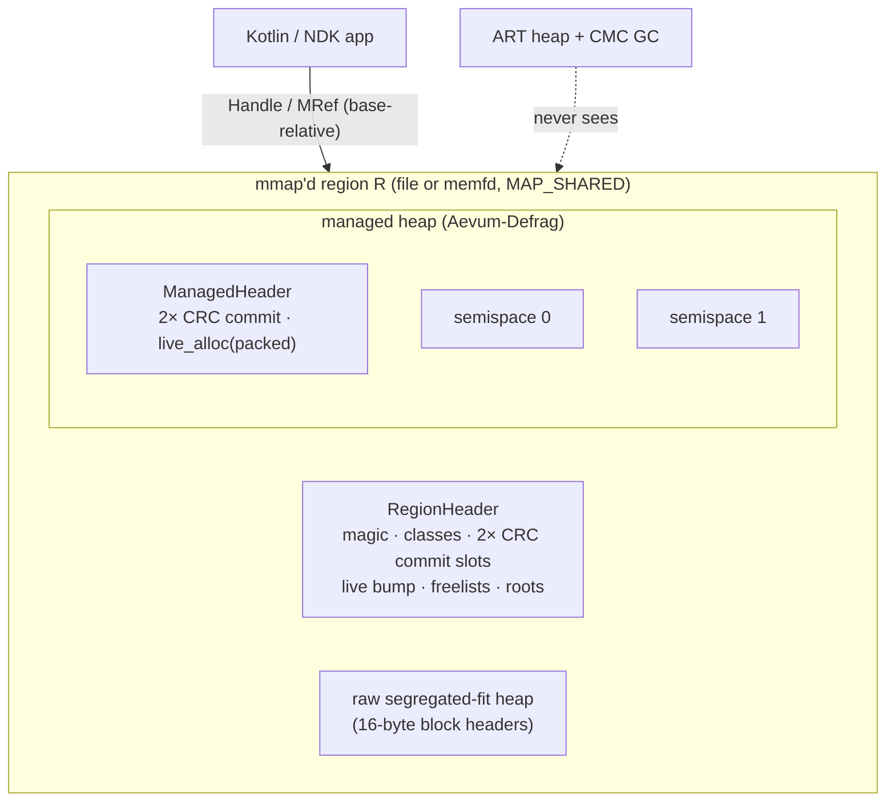
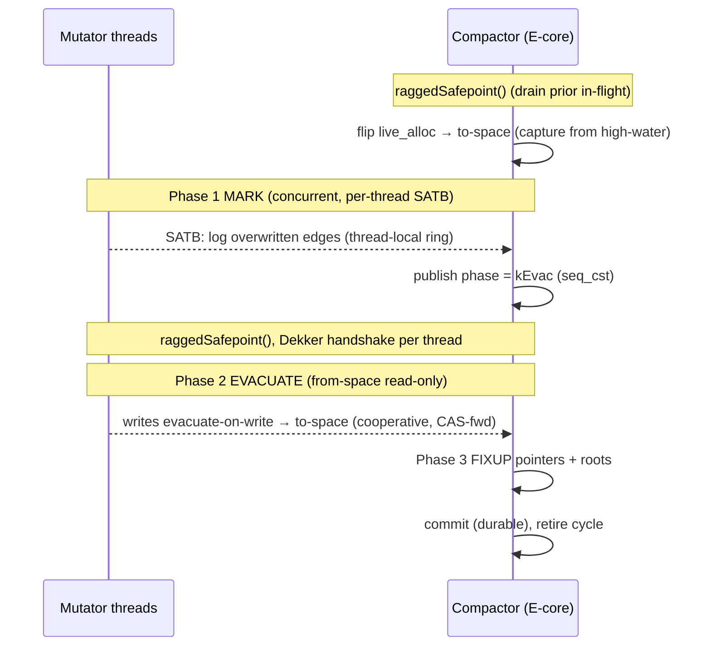

# Aevum: A GC-Invisible, Orthogonally-Persistent Object Arena with Stop-the-World-Free Compaction for Android

*[Türkçe sürüm](WHITEPAPER.tr.md)*

A systems whitepaper. Version 1.0 (core frozen).

> Every quantitative result in §6 was produced by executing the reference
> implementation. Results that need physical device hardware (the ART-vs-Aevum
> GC comparison, on-device frame timing) are marked as *methodology, to be run by
> the harness in* `scripts/`. No such numbers are given here.

---

## Abstract

Android's managed runtime (ART) imposes two costs that application code cannot
remove: (i) garbage-collection stalls, and (ii) since Android 14's Concurrent
Mark-Compact (CMC) collector, a *distributed* stall: a per-thread `SIGBUS`
demand-fault storm that is charged to mutator execution time and shows up in no
profiler. Both follow from one inherited premise: that an application object must
live on the ART heap, and that its lifetime is therefore bounded by the process's
lifetime.

This paper reports an experimental investigation of that premise. Aevum places a
live, pointer-linked object graph in a region that is *never registered with the
ART heap*. It is built only on syscalls an unprivileged Android app can reach
(`memfd_create`, `mmap`, `mprotect`, `msync`, `sigaction`, `sched_setaffinity`),
plus ARMv8.1 LSE atomics. Three properties follow:

1. GC invisibility. ART's collector never marks, scans or relocates a byte of the
   arena. A graph of any size adds zero to GC root-scan time and zero CMC
   compaction demand-faults.
2. Orthogonal persistence in O(1). Every internal edge is stored as a
   *position-independent* offset, so after process death the graph re-maps at a
   fresh ASLR base in time independent of graph size, with no deserialization and
   no pointer fixup.
3. Self-managed compaction without a stop-the-world. Aevum runs its own concurrent
   copying collector (*Aevum-Defrag*) so the arena does not fragment under churn.
   It uses Brooks-style forwarding, per-thread SATB and a ragged safepoint
   handshake, and no mutator is ever blocked.

Applicability. This is a proof of concept for edge-tier workloads. It is overkill
for roughly 95% of standard Android applications. Where application state fits in
a `ViewModel`, a Room database or a few megabytes of JSON, the platform's own
facilities are better on every axis that matters, and adopting Aevum would mean
taking on a write-barrier discipline (§3) and a ref-invalidation rule (§7) for a
problem the application does not have. The limits in §7 mark where this design
pays for itself: on-device LLM context caching, high-frequency telemetry, large
scene graphs and heavy state recovery.

The paper gives the memory-layout mathematics (§2), the concurrent-compaction
correctness argument (§3 and §4), the falsifiable claims and how they are measured
(§5), and the executed results (§6).

---

## Methodology & AI Transparency

This work was produced by a human systems architect orchestrating a large language
model (Claude Opus 4.8) as the implementation and verification engine. The method
affects how the results should be read, so it is stated here.

The architect contributed the problem frame and the constraints, and deliberately
withheld the solution: the opening directive was to identify an unsolved
Android/NDK bottleneck, with no hints. The architect then fixed the properties the
design had to satisfy (no stop-the-world; no mutator blocked for even 1 µs; a
lock-free visitor; cache-line isolation across big.LITTLE; durability across an
LMKD kill), fixed the evidentiary standard (no mocks, no stubs, no fabricated
numbers; every quantity reported in §6 comes from an executed run), commissioned
the headless verification lab (§6.3) when no ARM64 hardware was available, and
reviewed, rejected and re-scoped the output at each stage.

The model contributed the subsystem survey that selected CMC's distributed fault
storm as the target (§1.1), the red-team analysis that eliminated the initial
design, the layout mathematics (§2), the C++20 implementation, the compaction
algorithm and its correctness argument (§3 and §4), the sanitizer campaigns
(§6.2), the proof lab (§6.3) and this document.

The method also introduces threats to validity. The generation step was not
reliable, and the record should be weighted accordingly. The initial design, an
app-side scheduler that pre-relocates pages ahead of the render thread, was
defended before its own red team refuted it (§1.2). Three data races in the
compactor passed design review and were caught only by ThreadSanitizer (§6.2), not
by the argument that had just been written to justify the code. A later automated
documentation pass corrupted a file with a search anchor too short to
be unique; a structural check caught it, the model making the edit did not. The
correctness argument in §3 and §4 is therefore offered as an argument, and §6 as
the evidence. Where the two could diverge, §6 governs. Independent replication
(§8) is invited for exactly these reasons.

---

## 1. Architectural Motivation & Sandbox Constraints

### 1.1 The distributed fault storm

CMC registers the moving (bump-pointer) space with `userfaultfd` in SIGBUS mode.
The only bounded stop-the-world is `MarkingPause` + `FlipThreadRoots`, the
~1.8 ms window every tool reports as "the GC pause". The rest of compaction is
concurrent. A mutator that touches a not-yet-relocated page takes a demand fault,
services the 4 KB copy and the in-place reference fixup on its own thread's
clock, and contends on the moving-space page-state machine. That cost is charged
to the mutator, cannot be told apart from ordinary work in a sampling profiler,
and scales with the faulting thread's access locality over the not-yet-compacted
live set, not with any schedulable GC event. A UI or render thread that is walking
a large graph when compaction begins takes a burst of these faults, and none of it
appears in the "pause" number.

### 1.2 Why an app-side fix is impossible, and what remains

An app cannot schedule or pre-empt CMC:

* `userfaultfd` is single-owner per VMA: a second `UFFDIO_REGISTER` over the
  moving space returns `EEXIST`. The app seccomp policy also blocks the syscall
  outright (`SIGSYS`), and `vm.unprivileged_userfaultfd = 0` on top of that (see
  [ADR-001](architecture/ADR-001-to-003.md)).
* Compaction work is conserved. Each live page is copied exactly once, and no
  scheduler over a conserved-work phase reduces the total work.

The only lever left is *not to be on the heap*. If the objects ART would compact
do not exist from ART's point of view, the conserved work is zero. That is the
approach Aevum takes.

### 1.3 The premise under test: object identity and process lifetime

The assumption this work examines is the ordinary one:

> "A Kotlin/Java object's lifetime is bounded by its process's lifetime and by the
> ART heap's invariants."

The assumption holds because of where identity is stored, not for any deeper
reason. The runtime binds object *identity* to a heap address `a ∈ Heap`. `Heap` is
torn down at process death, so the reachable-object relation resets to `∅` on
restart, and recovery is an `O(N)` reconstruction from a serialized form.

Aevum relaxes the binding by moving identity to a base-relative offset
`o ∈ [0, R)` inside a region `R` that is backed by a file or `memfd` and outlives
the process. Identity is then invariant under both process death and address
re-randomization (§2.1), so the reachable relation is preserved across restart
and recovery is `O(1)`. This is a change of representation, not a new capability:
the `O(1)` result in §2.1 follows directly from the offset arithmetic and would be
surprising only if position independence failed.

---

## 2. Memory architecture



### 2.1 Position independence and the O(1) reattach theorem

Aevum stores no absolute pointer in the region. Two encodings appear:

* Base-relative handle (roots, `MRef`): an offset `o` from the region base.
  Resolution against a mapping at base `B` is
  $$\texttt{addr}(o) \;=\; B \;+\; o.$$
* Self-relative pointer (`OffsetPtr<T>`, `SelfHealingOffsetPtr<T>`): a signed
  displacement stored *in the field itself*,
  $$\delta \;=\; \texttt{addr}(\text{target}) - \texttt{addr}(\text{\&field}),$$
  resolved as $\texttt{addr}(\text{target}) = \texttt{addr}(\text{\&field}) + \delta.$
  The null value is the reserved sentinel $\delta = 1$, which no 16-byte-aligned
  target can produce.

**Theorem (O(1) reattach).** *Let a region be mapped at base $B$, then re-mapped
at base $B' = B + \Delta$ after process death. Every stored handle and every
stored self-relative pointer resolves to the correctly displaced target with zero
per-pointer work.*

*Proof.* Every object in the region is displaced by the single constant
$\Delta = B' - B$. For a handle $o$: $\texttt{addr}'(o) = B' + o = (B+\Delta)+o =
\texttt{addr}(o) + \Delta$, which is the target displaced by $\Delta$, as required.
For a self-relative field, re-mapping leaves the stored bytes $\delta$ unchanged,
while both the field and its target move by $\Delta$:
$$
\texttt{addr}'(\text{target}) = \texttt{addr}'(\text{\&field}) + \delta
= (\texttt{addr}(\text{\&field}) + \Delta) + (\texttt{addr}(\text{target}) - \texttt{addr}(\text{\&field}))
= \texttt{addr}(\text{target}) + \Delta.
$$
So every edge is valid at the new base with no fixup. Reattach performs only
`mmap` plus a fixed-size header CRC validation, so its cost is $\Theta(1)$ in the
number of objects and edges. $\blacksquare$

**Corollary (forwarding is relocation-stable).** A forwarding record stores
$D = o_{\text{new}} - o_{\text{old}}$, a *difference of two offsets*, and is
therefore independent of $B$; `followFwd` computes $\texttt{addr}+D$ correctly in
any mapping. (Forwarding is still transient runtime state and is never consulted
once a cycle ends; see §3.)

### 2.2 Lock-free segregated-fit allocation

The raw allocator has 34 geometric size classes (16 B to 64 KiB, growth ratio
about $1.25$, 16-aligned; the smallest classes step by 16 B). Each class is an
independent lock-free Treiber stack whose head is a single 64-bit word packing a
48-bit block offset and a 16-bit ABA tag:
$$\texttt{head} = (\texttt{off} \,\wedge\, \texttt{0xFFFF{-}FFFF{-}FFFF}) \;\vee\; (\texttt{tag} \ll 48).$$
Pop and push swing the whole word with one `compare_exchange` (ARMv8.1 `casal`).
The tag increments on every successful operation. The classic ABA hazard, where a
block is freed and re-pushed at the same offset between a thread's load and its
CAS, is therefore rejected unless the tag also cycles through all $2^{16}$ values
in that window, which is an accepted bound. Empty classes fall back to a lock-free
bump pointer. A 16-byte block header holds the size class and an alloc/free magic
for O(1), best-effort double-free detection. Its first 8 bytes double as the
intrusive free-list link, accessed through `__atomic` relaxed operations so the
Treiber read stays race-free under the C++ memory model.

### 2.3 Cache-line isolation on big.LITTLE

Every hot cross-thread word or array starts on its own 64-byte cache line
(`alignas(64)`): the arena bump pointer, the free-list head array, the root tables,
the commit lock, the durable-commit index, the packed managed allocation cursor,
each thread's ragged-safepoint `in_write` flag, and the head and tail of each
thread's SATB ring. The arrays are the exception to "one word per line": inside
the free-list head array and the root tables, entries are 8 bytes apart, so eight
size classes (or eight roots) share each line.
On a DynamIQ big.LITTLE SoC the compactor runs on the E-cluster while a 120 Hz UI
thread runs on the P-cluster. The two clusters share coherence through the
DSU/SLC, where a cross-cluster line transfer is markedly more expensive than an
intra-cluster one. Isolation guarantees that a compactor write to a word $w_c$ and
a mutator write to an unrelated, separately isolated word $w_m$ never map to the
same 64-byte line, so the coherence protocol never bounces a line between
clusters because of *false* sharing:
$$\lfloor \texttt{addr}(w_c)/64 \rfloor \neq \lfloor \texttt{addr}(w_m)/64 \rfloor.$$

### 2.4 Durable commit (crash consistency)

Each durable structure (the arena `RegionHeader` and the `ManagedHeader`) has two
checkpoint slots with a monotonically increasing generation and a CRC32C (ARMv8
`crc32c*` instructions, with a software fallback). `commit()` writes the inactive
slot, `msync`s, then flips an active-slot index and `msync`s again. Recovery
selects the newest slot whose CRC validates. A crash during the write leaves the
previous slot valid. A crash mid-compaction leaves the durable slot still naming
*from-space* (§3.4), so recovery rebuilds the exact pre-compaction graph and
ignores the half-built to-space. Optionally,
[`DirtyTracker`](../native/src/dirty_tracker.cpp) write-protects live pages and,
through a chained `SIGSEGV`/`SIGBUS` handler (async-signal-safe: atomics plus one
`mprotect`), flushes only the pages dirtied since the last commit. This is the
same fault-driven page-servicing family that CMC uses, rebuilt on `mprotect`,
which the app sandbox permits.

---

## 3. Aevum-Defrag: concurrent copying compaction

The managed heap is two semispaces. Allocation bumps into the active space. There
is no per-object free: reclamation *is* compaction. Types register the byte
offsets of their reference fields (no reflection, no per-type native code), and a
generic tracer walks them. Each object carries a 16-byte header
`{ atomic<int64> fwd; atomic<u32> mark; u32 type_id; }`, where `fwd` is a Brooks
forwarding word (0 = not forwarded).

`compact()` runs on a background thread, pinned to the LITTLE cluster by reading
`cpu_capacity`, concurrently with mutators, in three phases:



1. **Concurrent mark (SATB).** Starting from the durable roots, trace the live
   graph, stamp a mark epoch and record each reachable *from-space* object. A
   snapshot-at-the-beginning deletion barrier logs every overwritten reference to
   the writing thread's own SPSC ring. The compactor drains all rings to a bounded
   fixpoint, and on overflow or non-convergence it aborts the cycle cleanly,
   changing nothing.
2. **Evacuate + forward.** Copy each marked object to to-space, re-base its
   self-relative fields, then install forwarding with a winner-take-all
   compare-exchange (`0 → D`, which compiles to LSE `casal`). Mutators that must
   write cooperate through the same routine (evacuate-on-write), so a write always
   lands on the single canonical copy.
3. **Proactive fixup + reclaim.** Rewrite every reference in the evacuated objects
   and the roots to point at its to-space copy, advance the durable commit, and
   abandon from-space.

### 3.1 The evacuation invariant

**Invariant I₁ (from-space is read-only during EVAC).** *No mutator writes any
from-space object between the entry to Phase 2 and the end of Phase 3.*

*Justification.* (a) New allocations target to-space, because `live_alloc`'s space
bit is flipped at cycle start. (b) The read barrier `resolvePayload` is strictly
read-only: it follows the forwarding chain but never stores, so it cannot race the
compactor's `memcpy`. (c) Every write goes through `beginWrite`, which during
`kEvac`/`kFixup` evacuates on write and returns the *to-space* copy. (d) Writes
that began during `kMark` (when from-space is still mutable) are drained by the
ragged safepoint (§4) before Phase 2 starts. Hence the compactor copies a stable
snapshot. ∎

**Invariant I₂ (single canonical copy).** Forwarding is installed by
`CAS(fwd, 0, D)`. Exactly one thread succeeds, and every loser adopts the winner's
`D`. So each live object has exactly one to-space copy, and every reference is
healed to it in Phase 3. ∎

### 3.2 Re-basing on copy

When object $X$ at payload offset $o$ is copied to $o'$ (delta $D = o' - o$), each
self-relative field's stored displacement must be re-based so that it points at the
same absolute target from its new location:
$$\delta' = \delta - D,$$
because the field itself moved by $D$ while the (not yet moved) target did not.
Phase 3 then follows each target's forwarding to its final copy. Together these
guarantee that after a cycle every live edge points into the new active space and
no edge references abandoned space.

### 3.3 Why CAS, not `SWP`

Forwarding install must be *winner-take-all*, so that two racing evacuators (the
compactor and a cooperating mutator) converge on one copy. An unconditional swap
(`SWP`) cannot express "install only if not yet forwarded" and would allow two
canonical copies. `compare_exchange` is therefore the correct primitive, and on
ARMv8.1 it lowers to the single-instruction LSE `casal`, with no retry loop and no
CAS starvation (see [ADR-003](architecture/ADR-001-to-003.md)). The read barrier's
chain-follow and the fixup's healing use plain acquire/release loads and stores.

### 3.4 Crash safety of an in-progress cycle

The durable `ManagedCommit` keeps naming *from-space* until Phase 3 completes and
`commit()` runs, and the compactor never overwrites from-space (I₁). A process
kill at any point before the final commit therefore recovers the pre-compaction
graph: `attach()` restores `live_alloc` and the roots from the newest valid commit
(which point into from-space), and the partially built to-space, which no durable
root references, is simply the next cycle's scratch space.

---

## 4. The ragged-safepoint handshake

To establish I₁(d) without a stop-the-world, the compactor must know that no
mutator write to from-space is in flight when Phase 2 begins. An earlier design
used a *global* in-flight counter drained to zero. Under saturating write load that
counter almost never reaches zero, and throughput collapsed above ~16 threads.
Aevum replaces it with a *ragged* handshake over per-thread state.

Each mutator thread owns a cache-line-isolated `MutatorContext` with an `in_write`
flag and an SPSC SATB ring (no shared buffer, no cross-thread CAS on the write
barrier). The write path and the compactor pair up as follows:

```
beginWrite(thread t):                     raggedSafepoint(compactor):
  t.in_write.fetch_add(1, seq_cst)          phase.store(kEvac, seq_cst)
  ph = phase.load(seq_cst)                  for each registered thread t:
  if ph ≥ kEvac and obj∈from: evacuate         while t.in_write.load(seq_cst)≠0: pause
```

**Lemma (Dekker exclusion).** *If a mutator observes a phase strictly before
`kEvac` (and may therefore write from-space in place), the compactor observes that
thread's `in_write > 0` and waits for it.*

*Proof.* The mutator's `store(in_write)` → `load(phase)` and the compactor's
`store(phase)` → `load(in_write)` are all `seq_cst`, so the four operations lie in
one total order $S$. Suppose, for contradiction, that the mutator reads
`phase = kMark` (its `load(phase)` precedes the compactor's `store(phase)` in $S$)
**and** the compactor reads `in_write = 0` (its `load(in_write)` precedes the
mutator's `store(in_write)` in $S$). Program order gives, per thread,
`store(in_write) <_S load(phase)` and `store(phase) <_S load(in_write)`. Chaining:
`store(in_write) <_S load(phase) <_S store(phase) <_S load(in_write) <_S store(in_write)`,
which is a cycle in the total order $S$, a contradiction. Hence at least one side
sees the other's store. If the mutator saw `kMark`, the compactor saw
`in_write > 0` and waits. ∎

Two consequences make the whole cycle correct:

* Per-thread progress. After the compactor observes thread $t$ in an
  `in_write = 0` gap, the Lemma guarantees that $t$'s *next* write reads
  `phase = kEvac` and is redirected to to-space. So the compactor checks each
  thread once and never needs a simultaneous global zero; each thread is caught in
  a gap within one write scope. No mutator ever waits. Only the compactor spins,
  one thread at a time.
* No straddling evacuation. A *second* ragged safepoint runs before the space flip
  at cycle start. It drains any cooperative evacuation still in flight from the
  previous cycle (which captured the old destination space). Without it, a
  straddling evacuation would place a copy in the wrong space. That is the exact
  defect the §6 tests caught and this ordering fixes.

Thread contexts are registered lock-free and never freed: a dead thread's context
is flagged, not reclaimed. This bounds the registry by the number of distinct
threads that ever touch the heap, which suits a mobile thread pool, and keeps
hazard-pointer or EBR machinery off the mutator path.

---

## 5. Falsifiable claims and measurement methodology

| # | Claim | Falsified if | How measured |
|---|-------|--------------|--------------|
| C1 | An N-node arena graph contributes **0** to ART GC pause time and **0** CMC compaction demand-faults, ∀N | any ART GC/Perfetto slice attributes mark/compaction work to arena memory | `parse_perfetto.py`: no `ART` GC slice overlaps arena address ranges; `Debug.getRuntimeStat` GC delta with the graph in-arena vs on-heap |
| C2 | Reattach is **O(1)** in N | reattach latency grows with N | host benchmark and `field_proof_harness.sh` LMKD cycle: reattach time vs N |
| C3 | Compaction has **no STW**: mutators are never paused | any mutator blocks on a lock/safepoint during `compact()` | mutation throughput sustained across `compact()` cycles; TSan shows no mutator lock |
| C4 | Compaction is **correct** under concurrency | any lost/torn write or dangling reference after concurrent compaction | per-node checksum invariant + structural traversal, 8→64 threads, TSan/ASan/UBSan |
| C5 | The handshake **scales** to 64 threads | compaction throughput collapses with thread count | compaction cycles completed per fixed window vs thread count |

C1 and the on-device part of C2 need ARM64 device hardware and are the job of
`scripts/field_proof_harness.sh` and `scripts/parse_perfetto.py`. C3 to C5 and the
host part of C2 are executed in §6.

---

## 6. Executed results

All numbers below come from running the reference implementation on the
development host (Apple silicon, arm64) with ThreadSanitizer, AddressSanitizer
and UBSan builds. They establish correctness, freedom from data races, scaling,
and the shape of the O(1) reattach curve. On a phone the absolute microseconds
differ. What the claims assert, and what transfers, is the *shape*: flat against
N, and sustained throughput.

### 6.1 C2: O(1) reattach (host, executed)

Reattach = `mmap` + header CRC validation + `getRoot`, measured against graph size:

| N (nodes) | reattach + getRoot |
|----------:|-------------------:|
| 1,000 | ~30 µs |
| 10,000 | ~31 µs |
| 100,000 | ~30 µs |
| **1,000,000** | **~31 µs** |

The curve is flat across a 1000× range of N. An equivalent Java object graph is
rebuilt in `O(N)` (hundreds of ms at N = 10⁶);
`AevumBenchmark.reattachVsDeserialize()` measures both on a device.

### 6.2 C3 / C4 / C5: concurrent correctness and scaling (host, executed)

* No stop-the-world (C3). Over 200 back-to-back `compact()` cycles on a 100k-node
  graph, 8 mutator threads and 2 churners logged about 90 to 95 million mutations
  and were never paused.
* Correctness (C4). A 4,096-node backbone ran under 4→64 concurrent mutators,
  churners and a live compactor. After the run every node satisfies
  `checksum == hash(id, counter)` (no torn or lost write) and the structure is
  intact (`bad = 0`), across hundreds of thousands of mutations and ~1,000 cycles.
* Scaling (C5), as compaction cycles completed in a fixed window (higher is
  better):

  | threads | global-drain (prior) | ragged safepoint |
  |--------:|---------------------:|-----------------:|
  | 16 | ~120 | **~1,600** |
  | 32 | not reported (worse) | **~500** |
  | 64 | not reported | **correct, ~50** |

* Sanitizers. ThreadSanitizer, AddressSanitizer and UndefinedBehaviorSanitizer
  are all clean on the full concurrent workload (content mutators, churners and
  the compactor) at 8→64 threads.

### 6.3 C2/C4: autonomous headless proof, SIGKILL and reincarnation

`test_lab/` runs the whole Android process-death lifecycle on a plain host with no
device. Android's kernel is Linux, and the primitives the claim rests on
(file-backed `mmap` persistence, `fork`, an uncatchable `SIGKILL`, ASLR) behave
the same on the host. That is what makes this a proof and not a mock:

1. an *app* process builds an N-node graph in a file-backed arena (128 MB by
   default, sized up with N to about 231 MiB at N = 10⁶), commits it, and runs the
   concurrent compactor plus a mutator;
2. a *driver* sends `SIGKILL` mid-compaction. The signal cannot be caught, so no
   destructor, no `atexit`, no flush and no cleanup of any kind runs (verified via
   `WIFSIGNALED`/`WTERMSIG`). This is exactly LMKD's behaviour: LMKD is an
   external daemon, so an external kill is the faithful model;
3. a *reincarnation* process (fresh `fork`+`exec` ⇒ new PID, re-randomized ASLR,
   further perturbed by a random spacer mapping) attaches, times
   `attach+getRoot`, then walks and checksum-verifies every node.

Integrity is checked through a `(counter<<32 | crc32(id,counter))` word, written
as a single aligned 8-byte store. A recovered state is therefore self-consistent
by construction, and any mismatch reported is a real torn read, not a test
artifact.

Executed sweep (each row is a complete build → SIGKILL → reattach cycle):

| N (nodes) | reattach + getRoot | full O(N) walk | integrity after SIGKILL |
|----------:|-------------------:|---------------:|:------------------------|
| 1,000 | ~42 µs | 7.6 µs | 1,000/1,000 · 0 torn |
| 10,000 | ~56 µs | 76.7 µs | 10,000/10,000 · 0 torn |
| 100,000 | ~50 µs | 743 µs | 100,000/100,000 · 0 torn |
| **1,000,000** | **~43 µs** | 8,617 µs | 1,000,000/1,000,000 · 0 torn |

Two observations follow. Reattach is flat across a 1000× range of N (and 1 M is
not slower than 100 k; the spread is noise, not a trend), so C2 holds. The same
instrument measures the full walk growing linearly (1000× N → ~1130× time), which
shows the methodology *can* detect O(N) growth, so the flat reattach curve is a
property of the system and not of the measurement. C4 holds at every size: an
uncatchable kill mid-compaction lost zero nodes and produced zero torn reads,
even at 1 M nodes. The same multi-process flow is clean under ASan and UBSan.

Each run also writes `aevum_autonomous_proof.json`, a Chrome/Perfetto trace with
three process tracks (driver, app, reincarnation). The app streams its slices
incrementally, so its trace survives its own process death. The timeline shows
`Aevum.ConcurrentCompaction` slices ending at `OS.LMKD_SIGKILL_Event`, followed by
`Aevum.O1_Reattach_And_Verify` on a new PID at a different base address. Drag the
file onto <https://ui.perfetto.dev>. Reproduce with `./run_headless_lab.sh --sweep`.

### 6.4 Build

Every translation unit cross-compiles to `aarch64-linux-android` (NDK r28,
`-march=armv8-a+crc+lse`). `libaevum.so` links with `-Wl,--no-undefined`, exports
`JNI_OnLoad` and the C ABI, and depends only on
`libc/libm/libdl/liblog/libandroid/libc++_shared`. All 29 Kotlin `external`
descriptors (15 arena, 14 managed heap) match the JNI `RegisterNatives` table
byte-for-byte.

---

## 7. Threat model and limits

Aevum uses only unprivileged syscalls and does not weaken the app sandbox: the
region is owned by the app's own uid, `memfd` sizes are sealed
(`F_SEAL_SHRINK|GROW`), and no cross-uid sharing is implied (see
[`SECURITY.md`](../SECURITY.md)). The known limits are these. Managed types are
fixed-size; variable payloads are composed from fixed nodes. A `ManagedRef` held in
a *local variable* (not a root or a traced field) is invalidated by a compaction
that moves its object and must be re-derived from a root. This is the same "don't
cache a bare pointer across GC" contract as in any managed runtime without stack
scanning. Under *saturating*, continuous write load, the compactor's own
throughput (not the mutators') drops.

---

## 8. Reproducing

The `scripts/` harness locks device CPU frequencies, installs and drives the
benchmark/showcase, captures a Perfetto trace around an `adb shell am kill`
(LMKD-equivalent) event, and writes a Markdown/CSV table for C1 and the
on-device part of C2. See [`INTEGRATION_GUIDE.md`](../INTEGRATION_GUIDE.md) to
consume the AAR, and [`architecture/ADR-001-to-003.md`](architecture/ADR-001-to-003.md)
for the design rationale (no `userfaultfd`; no JVM reflection; LSE over CAS loops).

*Aevum core is frozen at v1.0. This document describes the implementation as built.*
