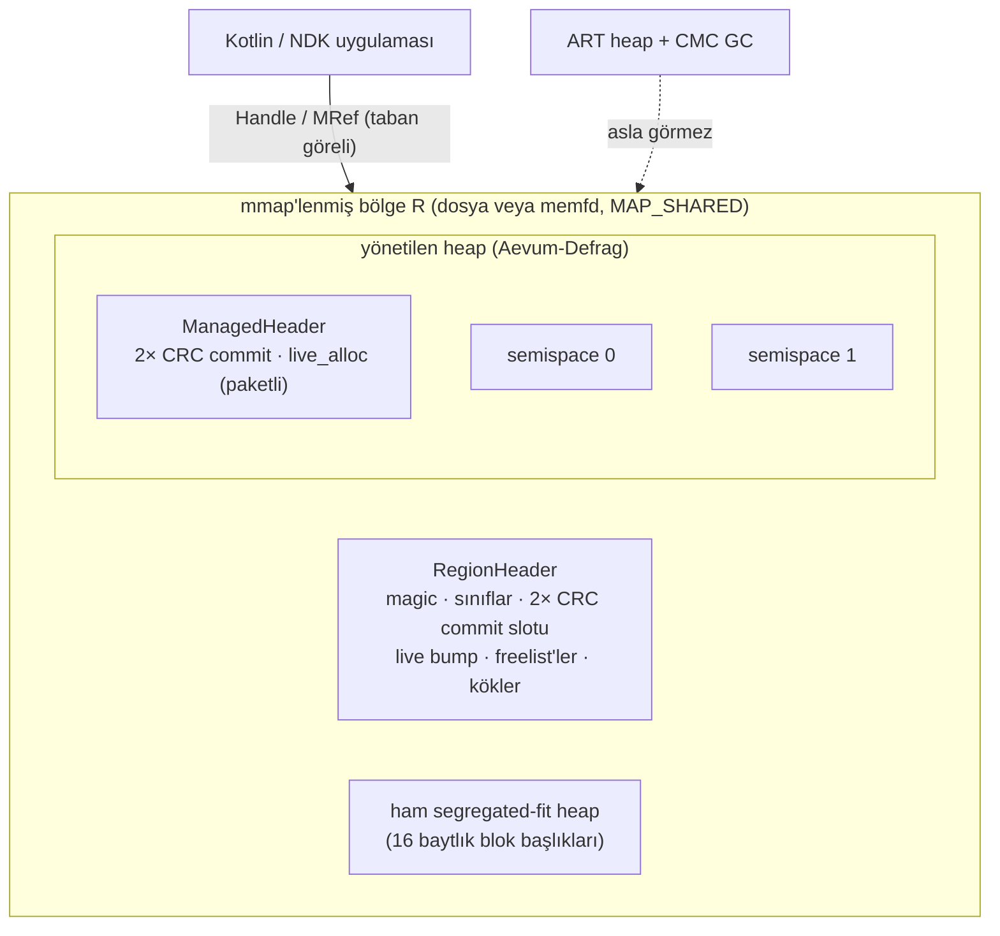
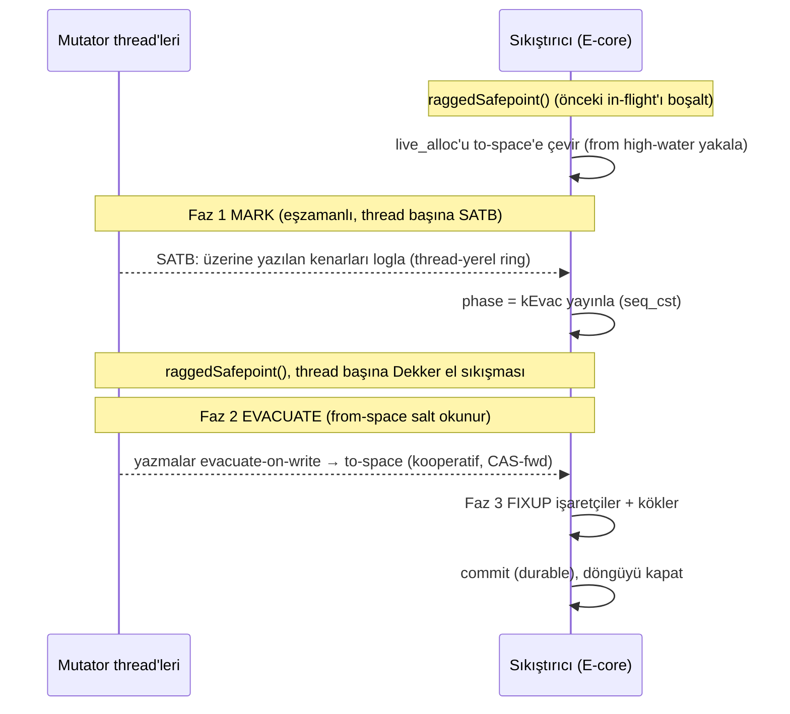

# Aevum: Android için GC'ye Görünmez, Ortogonal Kalıcı Nesne Arenası ve Sıfır Duraklamalı Sıkıştırma

*[English version](WHITEPAPER.md)*

Sistem programlama makalesi. Sürüm 1.0 (çekirdek donduruldu).

> §6'daki her nicel sonuç, referans implementasyon çalıştırılarak elde edildi.
> Fiziksel cihaz gerektiren sonuçlar (ART ile Aevum'un GC karşılaştırması, cihaz
> üstünde kare zamanlaması) *`scripts/` altındaki harness ile koşturulacak
> metodoloji* olarak işaretlendi. Bu tür sonuçlar için burada sayı verilmiyor.

---

## Özet

Android'in yönetilen çalışma zamanı (ART), uygulama kodunun ortadan
kaldıramayacağı iki maliyet getirir: (i) çöp toplama duraklamaları ve (ii) Android
14'ün Concurrent Mark-Compact (CMC) toplayıcısıyla birlikte gelen *dağıtılmış* bir
duraklama. İkincisi, mutator'ın çalışma süresine yazılan ve hiçbir profiler'da
görünmeyen, thread başına bir `SIGBUS` demand-fault fırtınasıdır. İkisi de miras
kalmış tek bir önermeden doğar: bir uygulama nesnesinin ART heap'inde yaşaması
gerektiği ve bu yüzden ömrünün süreç ömrüyle sınırlı olduğu.

Bu makale o önermeyi deneysel olarak inceliyor. Aevum, canlı ve işaretçilerle
birbirine bağlı bir nesne grafiğini *ART heap'ine hiç kaydedilmeyen* bir bölgeye
yerleştirir. Bunu yalnızca ayrıcalıksız bir Android uygulamasının erişebildiği
syscall'larla (`memfd_create`, `mmap`, `mprotect`, `msync`, `sigaction`,
`sched_setaffinity`) ve ARMv8.1 LSE atomikleriyle yapar. Bundan üç özellik çıkar:

1. GC görünmezliği. ART'ın toplayıcısı arenanın tek baytını bile işaretlemez,
   taramaz ya da taşımaz. Grafik, boyutu ne olursa olsun GC kök tarama süresine
   ve CMC compaction demand-fault'larına sıfır katkı yapar.
2. O(1) ortogonal kalıcılık. Her iç kenar *konumdan bağımsız* bir offset olarak
   saklandığı için grafik, süreç ölümünden sonra yeni bir ASLR tabanına grafik
   boyutundan bağımsız bir sürede yeniden map'lenir. Deserialization ve işaretçi
   düzeltmesi gerekmez.
3. Stop-the-world olmadan kendi sıkıştırması. Aevum, churn altında arenanın
   parçalanmaması için kendi eşzamanlı kopyalayan toplayıcısını (*Aevum-Defrag*)
   çalıştırır. Brooks tarzı forwarding, thread başına SATB ve ragged safepoint el
   sıkışması kullanır; hiçbir mutator bloklanmaz.

Uygulanabilirlik. Bu, uç iş yükleri için bir kavram kanıtıdır (PoC). Standart
Android uygulamalarının kabaca %95'i için gereğinden fazladır. Uygulama durumu bir
`ViewModel`'e, bir Room veritabanına ya da birkaç megabaytlık JSON'a sığıyorsa
platformun kendi araçları önemli olan her açıdan daha iyidir. Aevum'u benimsemek,
uygulamanın sahip olmadığı bir problem için bir write bariyeri disiplini (§3) ve
bir ref geçersizleşme kuralı (§7) üstlenmek demektir. §7'deki sınırlar, bu
tasarımın kendini nerede amorti ettiğini gösterir: cihaz üstü LLM bağlam
önbellekleme, yüksek frekanslı telemetri, büyük sahne grafikleri ve ağır durum
kurtarma.

Makale bellek yerleşiminin matematiğini (§2), eşzamanlı sıkıştırmanın doğruluk
argümanını (§3 ve §4), yanlışlanabilir iddiaları ve nasıl ölçüldüklerini (§5) ve
koşturulmuş sonuçları (§6) veriyor.

---

## Metodoloji & AI Şeffaflığı

Bu çalışma, bir insan sistem mimarının büyük bir dil modelini (Claude Opus 4.8)
implementasyon ve doğrulama motoru olarak yönetmesiyle üretildi. Yöntem, sonuçların
nasıl okunması gerektiğini etkilediği için burada açıkça yazılıyor.

Mimar problem çerçevesini ve kısıtları belirledi, çözümü ise bilerek vermedi: ilk
direktif, hiçbir ipucu olmadan çözülmemiş bir Android/NDK darboğazı bulmaktı.
Ardından tasarımın sağlaması gereken özellikleri sabitledi (stop-the-world yok;
hiçbir mutator 1 µs bile bloklanmayacak; kilitsiz bir ziyaretçi; big.LITTLE
genelinde cache line izolasyonu; bir LMKD öldürmesine karşı kalıcılık), kanıt
standardını sabitledi (mock yok, stub yok, uydurma sayı yok; §6'daki her nicelik
koşturulmuş bir çalışmadan gelir), ARM64 donanım olmadığında cihazsız doğrulama
lab'ını (§6.3) istedi ve her aşamada çıktıyı inceledi, reddetti ve kapsamını
yeniden çizdi.

Modelin payı şunlar oldu: CMC'nin dağıtılmış fault fırtınasını hedef olarak seçen
alt sistem taraması (§1.1), ilk tasarımı eleyen red-team analizi, yerleşim
matematiği (§2), C++20 implementasyonu, sıkıştırma algoritması ve doğruluk
argümanı (§3 ve §4), sanitizer turları (§6.2), kanıt lab'ı (§6.3) ve bu belge.

Yöntemin kendisi de geçerlilik açısından risk taşıyor. Üretim adımı güvenilir
değildi ve kayıt buna göre değerlendirilmeli. İlk tasarım (render thread'inin
önünden sayfaları önceden taşıyan, uygulama tarafında çalışan bir scheduler),
kendi red-team'i onu çürütmeden önce savunulmuştu (§1.2). Sıkıştırıcıdaki üç data
race tasarım incelemesinden geçti ve yalnızca ThreadSanitizer ile yakalandı
(§6.2); kodu gerekçelendirmek için az önce yazılmış argüman onları bulamadı. Daha
sonra otomatik bir dokümantasyon geçişi, benzersiz olamayacak kadar kısa bir arama
çıpası yüzünden bir dosyayı bozdu. Bunu düzenlemeyi yapan model değil,
yapısal bir kontrol yakaladı. Bu yüzden §3 ve §4'teki doğruluk argümanı bir argüman
olarak, §6 ise kanıt olarak sunuluyor. İkisi ayrışırsa §6 geçerlidir. Bağımsız
tekrar (§8) tam da bu nedenle davet ediliyor.

---

## 1. Mimari Gerekçe & Sandbox Kısıtları

### 1.1 Dağıtılmış fault fırtınası

CMC, taşınan (bump-pointer) alanı `userfaultfd` ile SIGBUS modunda kaydeder.
Sınırlı tek stop-the-world, her aracın "GC duraklaması" diye raporladığı ~1,8
ms'lik `MarkingPause` + `FlipThreadRoots` penceresidir. Sıkıştırmanın geri kalanı
eşzamanlı yürür. Henüz taşınmamış bir sayfaya dokunan mutator bir demand-fault
alır, 4 KB'lık kopyayı ve yerinde referans düzeltmesini kendi thread'inin
süresinden öder ve taşınan alanın sayfa durum makinesinde çekişmeye girer. Bu
maliyet mutator'a yazılır, örnekleme yapan bir profiler'da sıradan işten ayırt
edilemez ve herhangi bir planlanabilir GC olayıyla değil, fault alan thread'in
henüz sıkıştırılmamış canlı küme üzerindeki erişim yerelliğiyle ölçeklenir.
Sıkıştırma başladığı anda büyük bir grafiği gezen bir UI veya render thread'i bu
fault'lardan bir seri yer ve hiçbiri "duraklama" sayısında görünmez.

### 1.2 Uygulama tarafında düzeltme neden imkânsız, geriye ne kalıyor

Bir uygulama CMC'yi planlayamaz veya önüne geçemez:

* `userfaultfd` VMA başına tek sahiplidir: taşınan alan üzerine ikinci bir
  `UFFDIO_REGISTER` `EEXIST` döndürür. Üstelik uygulama seccomp politikası bu
  syscall'ı doğrudan engeller (`SIGSYS`) ve bunun üstüne
  `vm.unprivileged_userfaultfd = 0` gelir (bkz.
  [ADR-001](architecture/ADR-001-to-003.tr.md)).
* Sıkıştırma işi korunur. Her canlı sayfa tam olarak bir kez kopyalanır ve
  korunan iş miktarına sahip bir faz üzerinde hiçbir planlayıcı toplam işi
  azaltamaz.

Geriye kalan tek kaldıraç *heap'te olmamaktır*. ART'ın sıkıştıracağı nesneler
ART'ın gözünde yoksa korunan iş sıfırdır. Aevum'un yaklaşımı budur.

### 1.3 Sınanan önerme: nesne kimliği ve süreç ömrü

Bu çalışmanın incelediği varsayım sıradan bir varsayım:

> "Bir Kotlin/Java nesnesinin ömrü, sürecinin ömrüyle ve ART heap'inin
> değişmezleriyle sınırlıdır."

Varsayım daha derin bir nedenle değil, kimliğin nerede saklandığı yüzünden
geçerlidir. Çalışma zamanı nesne *kimliğini* bir heap adresine `a ∈ Heap` bağlar.
`Heap` süreç ölümünde yıkılır, dolayısıyla erişilebilir nesne bağıntısı yeniden
başlatmada `∅`'a döner ve kurtarma, serileştirilmiş bir formdan `O(N)` yeniden
inşa demektir.

Aevum bu bağı gevşetmek için kimliği, bir dosya veya `memfd` ile desteklenen ve
süreçten uzun yaşayan `R` bölgesi içindeki taban göreli bir offset'e
`o ∈ [0, R)` taşır. Kimlik böylece hem süreç ölümü hem adresin yeniden rastgele
seçilmesi altında değişmez (§2.1), erişilebilirlik bağıntısı yeniden başlatmadan
sonra da korunur ve kurtarma `O(1)` olur. Bu yeni bir yetenek değil, bir gösterim
değişikliğidir: §2.1'deki `O(1)` sonucu doğrudan offset aritmetiğinden çıkar ve
ancak konumdan bağımsızlık bozulsaydı şaşırtıcı olurdu.

---

## 2. Bellek mimarisi



### 2.1 Konumdan bağımsızlık ve O(1) reattach teoremi

Aevum bölgede hiçbir mutlak işaretçi saklamaz. İki kodlama kullanılır:

* Taban göreli handle (kökler, `MRef`): bölge tabanından bir `o` offset'i. `B`
  tabanındaki bir eşleme için çözümleme
  $$\texttt{addr}(o) \;=\; B \;+\; o.$$
* Kendine göreli işaretçi (`OffsetPtr<T>`, `SelfHealingOffsetPtr<T>`): *alanın
  kendisinde* saklanan işaretli bir yer değiştirme,
  $$\delta \;=\; \texttt{addr}(\text{hedef}) - \texttt{addr}(\text{\&alan}),$$
  çözümlemesi $\texttt{addr}(\text{hedef}) = \texttt{addr}(\text{\&alan}) + \delta.$
  Null değeri, 16 bayt hizalı hiçbir hedefin üretemeyeceği, ayrılmış
  $\delta = 1$ değeridir.

**Teorem (O(1) reattach).** *Bir bölge $B$ tabanında map'lensin, süreç ölümünden
sonra da $B' = B + \Delta$ tabanında yeniden map'lensin. Saklanan her handle ve her
kendine göreli işaretçi, işaretçi başına sıfır işle, doğru biçimde ötelenmiş
hedefe çözümlenir.*

*İspat.* Bölgedeki her nesne aynı $\Delta = B' - B$ sabitiyle ötelenir. Bir $o$
handle'ı için $\texttt{addr}'(o) = B' + o = (B+\Delta)+o = \texttt{addr}(o) +
\Delta$ olur; bu da istendiği gibi $\Delta$ kadar ötelenmiş hedeftir. Kendine
göreli bir alanda yeniden map'leme saklanan $\delta$ baytlarını değiştirmez, alan
ve hedefi ise $\Delta$ kadar kayar:
$$
\texttt{addr}'(\text{hedef}) = \texttt{addr}'(\text{\&alan}) + \delta
= (\texttt{addr}(\text{\&alan}) + \Delta) + (\texttt{addr}(\text{hedef}) - \texttt{addr}(\text{\&alan}))
= \texttt{addr}(\text{hedef}) + \Delta.
$$
Böylece her kenar yeni tabanda düzeltme gerektirmeden geçerlidir. Reattach yalnızca
`mmap` ve sabit boyutlu bir başlık CRC doğrulaması yapar; maliyeti nesne ve kenar
sayısına göre $\Theta(1)$'dir. $\blacksquare$

**Sonuç (forwarding taşımaya dayanıklıdır).** Bir forwarding kaydı
$D = o_{\text{yeni}} - o_{\text{eski}}$ değerini, yani *iki offset'in farkını*
saklar ve bu yüzden $B$'den bağımsızdır; `followFwd` her eşlemede
$\texttt{addr}+D$'yi doğru hesaplar. (Forwarding yine de geçici bir çalışma zamanı
durumudur ve döngü bittikten sonra hiç okunmaz; bkz. §3.)

### 2.2 Kilitsiz segregated-fit tahsis

Ham tahsisleyicide 34 geometrik boyut sınıfı vardır (16 B ile 64 KiB arası,
büyüme oranı yaklaşık $1.25$, 16 bayt hizalı; en küçük sınıflar 16 B'lık adımlarla
ilerler). Her sınıf bağımsız, kilitsiz bir Treiber yığınıdır ve başı, 48 bitlik bir
blok offset'ini ve 16 bitlik bir ABA etiketini tek bir 64 bitlik kelimede paketler:
$$\texttt{head} = (\texttt{off} \,\wedge\, \texttt{0xFFFF{-}FFFF{-}FFFF}) \;\vee\; (\texttt{tag} \ll 48).$$
Pop ve push kelimenin tamamını tek bir `compare_exchange` (ARMv8.1 `casal`) ile
değiştirir. Etiket her başarılı işlemde artar. Bir bloğun, bir thread'in load'u ile
CAS'i arasında serbest bırakılıp aynı offset'e geri itildiği klasik ABA tehlikesi
bu yüzden reddedilir; tek istisna, etiketin aynı pencerede $2^{16}$ değerin
tamamını dolaşmasıdır ve bu kabul edilmiş bir sınırdır. Boş sınıflar kilitsiz bir
bump pointer'a düşer. 16 baytlık blok başlığı, boyut sınıfını ve O(1), en iyi çaba
düzeyinde çift free tespiti için bir alloc/free magic değerini tutar. İlk 8 baytı
aynı zamanda intrusive free-list bağı olarak kullanılır ve C++ bellek modeli
altında Treiber okumasını yarışsız tutmak için `__atomic` relaxed işlemlerle
okunup yazılır.

### 2.3 big.LITTLE üzerinde cache line izolasyonu

Thread'ler arasında sık erişilen her kelime veya dizi kendi 64 baytlık cache
line'ında başlar (`alignas(64)`): arenanın bump pointer'ı, free-list başlarının
dizisi, kök tabloları, commit kilidi, durable commit indeksi, yönetilen heap'in
paketli tahsis imleci, her thread'in ragged safepoint `in_write` bayrağı ve her
thread'in SATB ring'inin head ve tail'i. "Satır başına bir kelime" kuralının
istisnası dizilerdir: free-list başı dizisinde ve kök tablolarında girdiler 8 bayt
arayla durur, yani her satırı sekiz boyut sınıfı (ya da sekiz kök) paylaşır.
DynamIQ big.LITTLE bir SoC'de sıkıştırıcı E-cluster'da, 120 Hz'lik UI thread'i ise
P-cluster'da çalışır. İki cluster tutarlılığı DSU/SLC üzerinden paylaşır ve
cluster'lar arası bir satır transferi cluster içi transferden belirgin şekilde
pahalıdır. İzolasyon, sıkıştırıcının bir $w_c$ kelimesine yazmasıyla mutator'ın
ilgisiz ve ayrı izole edilmiş bir $w_m$ kelimesine yazmasının asla aynı 64 baytlık
satıra düşmemesini garanti eder. Böylece tutarlılık protokolü *yanlış* paylaşım
yüzünden bir satırı cluster'lar arasında gidip getirmez:
$$\lfloor \texttt{addr}(w_c)/64 \rfloor \neq \lfloor \texttt{addr}(w_m)/64 \rfloor.$$

### 2.4 Durable commit (çökme tutarlılığı)

Her durable yapıda (arena `RegionHeader`'ı ve `ManagedHeader`) monoton artan bir
generation ve bir CRC32C (ARMv8 `crc32c*` komutları, yazılım yedeğiyle) taşıyan iki
checkpoint slotu vardır. `commit()` aktif olmayan slotu yazar, `msync` çağırır,
sonra aktif slot indeksini çevirir ve yeniden `msync` çağırır. Kurtarma, CRC'si
doğrulanan en yeni slotu seçer. Yazma sırasında bir çökme olursa önceki slot
geçerli kalır. Sıkıştırmanın ortasında bir çökme olursa durable slot hâlâ
*from-space*'i gösterir (§3.4); kurtarma sıkıştırma öncesindeki grafiği aynen
geri kurar ve yarım kalmış to-space'i yok sayar. İsteğe bağlı olarak
[`DirtyTracker`](../native/src/dirty_tracker.cpp) canlı sayfaları write-protect
eder ve zincirlenmiş bir `SIGSEGV`/`SIGBUS` handler'ı (async-signal-safe: atomikler
ve tek bir `mprotect`) üzerinden yalnızca son commit'ten beri kirlenen sayfaları
flush eder. Bu, CMC'nin kullandığı fault güdümlü sayfa servisleme yönteminin,
uygulama sandbox'ının izin verdiği `mprotect` üzerine yeniden kurulmuş hâlidir.

---

## 3. Aevum-Defrag: eşzamanlı kopyalayan sıkıştırma

Yönetilen heap iki semispace'ten oluşur. Tahsis, aktif alanda bump ile yapılır.
Nesne başına free yoktur: geri kazanım *sıkıştırmanın kendisidir*. Tipler
referans alanlarının bayt offset'lerini kaydeder (reflection yok, tipe özel native
kod yok) ve genel bir tracer bu offset'leri gezer. Her nesne 16 baytlık bir başlık
taşır: `{ atomic<int64> fwd; atomic<u32> mark; u32 type_id; }`. Buradaki `fwd` bir
Brooks forwarding kelimesidir (0 = forward edilmemiş).

`compact()`, `cpu_capacity` okunarak LITTLE cluster'a sabitlenen bir arka plan
thread'inde, mutator'larla eşzamanlı olarak üç fazda çalışır:



1. **Eşzamanlı mark (SATB).** Durable köklerden başlayarak canlı grafiği gezer,
   bir mark epoch'u damgalar ve erişilebilir her *from-space* nesnesini kaydeder.
   Snapshot-at-the-beginning silme bariyeri, üzerine yazılan her referansı yazan
   thread'in kendi SPSC ring'ine loglar. Sıkıştırıcı tüm ring'leri sınırlı bir sabit
   noktaya kadar boşaltır; taşma ya da yakınsamama durumunda döngüyü hiçbir şeyi
   değiştirmeden temiz biçimde iptal eder.
2. **Evacuate + forward.** İşaretlenen her nesneyi to-space'e kopyalar, kendine
   göreli alanlarını yeniden tabanlar, sonra kazananın her şeyi aldığı bir
   compare-exchange (`0 → D`, LSE `casal`'a derlenir) ile forwarding kurar. Yazması
   gereken mutator'lar aynı rutin üzerinden işbirliği yapar (evacuate-on-write);
   böylece bir yazma her zaman tek kanonik kopyaya düşer.
3. **Proaktif fixup + geri kazanım.** Tahliye edilen nesnelerdeki ve köklerdeki her
   referansı to-space kopyasını gösterecek şekilde yeniden yazar, durable commit'i
   ilerletir ve from-space'i bırakır.

### 3.1 Tahliye değişmezi

**Değişmez I₁ (EVAC boyunca from-space salt okunurdur).** *Faz 2'nin başından Faz
3'ün sonuna kadar hiçbir mutator hiçbir from-space nesnesine yazmaz.*

*Gerekçe.* (a) Yeni tahsisler to-space'e gider, çünkü `live_alloc`'un alan biti
döngü başında çevrilir. (b) Read bariyeri `resolvePayload` kesinlikle salt
okunurdur: forwarding zincirini takip eder ama hiç store yapmaz, bu yüzden
sıkıştırıcının `memcpy`'siyle yarışamaz. (c) Her yazma `beginWrite` üzerinden
geçer; `kEvac`/`kFixup` sırasında bu çağrı evacuate-on-write yapar ve *to-space*
kopyasını döndürür. (d) `kMark` sırasında (from-space hâlâ değiştirilebilirken)
başlamış yazmalar, Faz 2 başlamadan önce ragged safepoint (§4) tarafından
boşaltılır. Dolayısıyla sıkıştırıcı kararlı bir anlık görüntüyü kopyalar. ∎

**Değişmez I₂ (tek kanonik kopya).** Forwarding `CAS(fwd, 0, D)` ile kurulur. Tam
olarak bir thread başarılı olur ve kaybedenlerin hepsi kazananın `D` değerini
alır. Böylece her canlı nesnenin tam olarak bir to-space kopyası olur ve her
referans Faz 3'te o kopyaya yönlendirilir. ∎

### 3.2 Kopyalamada yeniden tabanlama

$o$ payload offset'indeki $X$ nesnesi $o'$ konumuna kopyalandığında
($D = o' - o$), kendine göreli her alanın saklanan yer değiştirmesi, yeni
konumundan aynı mutlak hedefi gösterecek şekilde yeniden tabanlanmalıdır:
$$\delta' = \delta - D,$$
çünkü alan $D$ kadar kaymıştır ama (henüz taşınmamış) hedef yerinde durur. Faz 3
ardından her hedefin forwarding'ini son kopyasına kadar takip eder. Bu ikisi
birlikte, bir döngüden sonra her canlı kenarın yeni aktif alanı göstermesini ve
hiçbir kenarın bırakılmış alanı göstermemesini garanti eder.

### 3.3 Neden CAS, neden `SWP` değil

Forwarding kurulumu *kazananın her şeyi aldığı* bir işlem olmalıdır ki yarışan iki
tahliyeci (sıkıştırıcı ve işbirliği yapan bir mutator) tek bir kopyada buluşsun.
Koşulsuz bir takas (`SWP`) "yalnızca henüz forward edilmemişse kur" koşulunu ifade
edemez ve iki kanonik kopyaya yol açabilir. Doğru primitif bu yüzden
`compare_exchange`'tir ve ARMv8.1'de tek komutluk LSE `casal`'a iner: retry döngüsü
yoktur, CAS açlığı yoktur (bkz. [ADR-003](architecture/ADR-001-to-003.tr.md)). Read
bariyerinin zincir takibi ve fixup'ın yönlendirmesi düz acquire/release load ve
store'larla yapılır.

### 3.4 Devam eden bir döngünün çökme güvenliği

Durable `ManagedCommit`, Faz 3 bitip `commit()` çalışana kadar *from-space*'i
göstermeye devam eder ve sıkıştırıcı from-space'in üzerine hiç yazmaz (I₁). Bu
yüzden son commit'ten önceki herhangi bir anda süreç öldürülürse sıkıştırma
öncesindeki grafik kurtarılır: `attach()`, `live_alloc`'u ve kökleri en yeni
geçerli commit'ten (from-space'i gösterenden) geri yükler. Yarım kalmış to-space'i
hiçbir durable kök göstermez; bir sonraki döngü orayı karalama alanı olarak
kullanır.

---

## 4. Ragged safepoint el sıkışması

I₁(d)'yi stop-the-world olmadan sağlamak için sıkıştırıcının, Faz 2 başladığında
from-space'e devam eden bir mutator yazması olmadığını bilmesi gerekir. Önceki bir
tasarım bunun için sıfıra kadar boşaltılan *global* bir in-flight sayacı
kullanıyordu. Doygun yazma yükü altında bu sayaç neredeyse hiç sıfıra inmez ve
~16 thread'in üstünde throughput çöküyordu. Aevum bunun yerine thread başına durum
üzerinde *ragged* bir el sıkışması kullanır.

Her mutator thread'inin, bir `in_write` bayrağı ve bir SPSC SATB ring'i (paylaşılan
tampon yok, write bariyerinde thread'ler arası CAS yok) içeren, cache line'a göre
izole bir `MutatorContext`'i vardır. Yazma yolu ve sıkıştırıcı şöyle eşleşir:

```
beginWrite(thread t):                     raggedSafepoint(sıkıştırıcı):
  t.in_write.fetch_add(1, seq_cst)          phase.store(kEvac, seq_cst)
  ph = phase.load(seq_cst)                  her kayıtlı t thread'i için:
  if ph ≥ kEvac ve obj∈from: evacuate          while t.in_write.load(seq_cst)≠0: pause
```

**Lemma (Dekker dışlaması).** *Bir mutator `kEvac`'tan kesin olarak önceki bir faz
görürse (ve bu yüzden from-space'e yerinde yazabilecekse), sıkıştırıcı o thread'in
`in_write > 0` değerini görür ve onu bekler.*

*İspat.* Mutator'ın `store(in_write)` → `load(phase)` işlemleri de sıkıştırıcının
`store(phase)` → `load(in_write)` işlemleri de `seq_cst`'tir, dolayısıyla dört
işlem tek bir toplam sıra $S$ içinde yer alır. Çelişki elde etmek için mutator'ın
`phase = kMark` okuduğunu (yani `load(phase)`'in $S$'de sıkıştırıcının
`store(phase)`'inden önce geldiğini) **ve** sıkıştırıcının `in_write = 0`
okuduğunu (yani `load(in_write)`'in $S$'de mutator'ın `store(in_write)`'inden önce
geldiğini) varsayalım. Program sırası her thread için
`store(in_write) <_S load(phase)` ve `store(phase) <_S load(in_write)` verir.
Bunları zincirlersek
`store(in_write) <_S load(phase) <_S store(phase) <_S load(in_write) <_S store(in_write)`
elde ederiz; bu $S$ toplam sırasında bir döngüdür, yani çelişkidir. Demek ki en az
bir taraf diğerinin store'unu görür. Mutator `kMark` gördüyse sıkıştırıcı
`in_write > 0` görmüştür ve bekler. ∎

Döngünün bütünüyle doğru olmasını iki sonuç sağlar:

* Thread başına ilerleme. Sıkıştırıcı $t$ thread'ini bir `in_write = 0` boşluğunda
  gördükten sonra Lemma, $t$'nin *bir sonraki* yazmasının `phase = kEvac` okuyup
  to-space'e yönleneceğini garanti eder. Böylece sıkıştırıcı her thread'i bir kez
  kontrol eder ve tüm thread'lerin aynı anda sıfırda olmasına hiç ihtiyaç duymaz;
  her thread en fazla bir yazma kapsamı içinde bir boşlukta yakalanır. Hiçbir
  mutator beklemez. Yalnızca sıkıştırıcı, her seferinde bir thread için döner.
* Döngü sınırını aşan tahliye olmaz. Döngü başında, alan çevrilmeden önce *ikinci*
  bir ragged safepoint çalışır. Bu, önceki döngüden kalan (eski hedef alanı
  yakalamış) ve hâlâ devam eden işbirlikçi tahliyeleri boşaltır. O olmasaydı,
  döngü sınırını aşan bir tahliye kopyayı yanlış alana koyardı. §6 testlerinin
  yakaladığı ve bu sıralamanın düzelttiği hata tam olarak budur.

Thread bağlamları kilitsiz olarak kaydedilir ve hiç serbest bırakılmaz: ölen bir
thread'in bağlamı işaretlenir ama geri alınmaz. Bu, kayıt defterini heap'e
dokunmuş farklı thread sayısıyla sınırlar; bir mobil thread havuzu için uygundur
ve mutator yolunu hazard pointer ya da EBR mekanizmalarından uzak tutar.

---

## 5. Yanlışlanabilir iddialar ve ölçüm metodolojisi

| # | İddia | Yanlışlanır eğer | Nasıl ölçülür |
|---|-------|------------------|---------------|
| C1 | N düğümlü bir arena grafiği ART GC duraklama süresine **0**, CMC compaction demand-fault'larına **0** katkı yapar, ∀N | herhangi bir ART GC/Perfetto dilimi arena belleğine mark/compaction işi atfederse | `parse_perfetto.py`: hiçbir `ART` GC dilimi arena adres aralıklarıyla örtüşmez; grafik arenadayken ve heap'teyken `Debug.getRuntimeStat` GC farkı |
| C2 | Reattach N'ye göre **O(1)**'dir | reattach gecikmesi N ile büyürse | host benchmark'ı ve `field_proof_harness.sh` LMKD döngüsü: N'ye karşı reattach süresi |
| C3 | Sıkıştırmada **STW yoktur**: mutator'lar hiç duraklatılmaz | `compact()` sırasında herhangi bir mutator bir kilit/safepoint'te bloklanırsa | `compact()` döngüleri boyunca korunan mutasyon throughput'u; TSan hiçbir mutator kilidi göstermez |
| C4 | Sıkıştırma eşzamanlılık altında **doğrudur** | eşzamanlı sıkıştırmadan sonra kayıp/yırtık yazma veya sarkan referans olursa | düğüm başına checksum değişmezi + yapısal gezinme, 8→64 thread, TSan/ASan/UBSan |
| C5 | El sıkışması 64 thread'e **ölçeklenir** | sıkıştırma throughput'u thread sayısıyla çökerse | thread sayısına karşı sabit bir pencerede tamamlanan sıkıştırma döngüsü sayısı |

C1 ve C2'nin cihaz üstü kısmı ARM64 cihaz donanımı gerektirir ve
`scripts/field_proof_harness.sh` ile `scripts/parse_perfetto.py`'nin işidir. C3,
C4, C5 ve C2'nin host kısmı §6'da koşturuldu.

---

## 6. Koşturulmuş sonuçlar

Aşağıdaki tüm sayılar referans implementasyonun geliştirme host'unda (Apple
silicon, arm64) ThreadSanitizer, AddressSanitizer ve UBSan derlemeleriyle
çalıştırılmasından geliyor. Doğruluğu, data race olmadığını, ölçeklenmeyi ve O(1)
reattach eğrisinin şeklini gösteriyorlar. Bir telefonda mikrosaniye değerleri
farklı olur. İddiaların öne sürdüğü ve cihaza taşınan şey *şekildir*: N'ye göre düz
bir eğri ve korunan throughput.

### 6.1 C2: O(1) reattach (host, koşturuldu)

Reattach = `mmap` + başlık CRC doğrulaması + `getRoot`, grafik boyutuna göre
ölçüldü:

| N (düğüm) | reattach + getRoot |
|----------:|-------------------:|
| 1.000 | ~30 µs |
| 10.000 | ~31 µs |
| 100.000 | ~30 µs |
| **1.000.000** | **~31 µs** |

Eğri N'nin 1000 katlık aralığında düz. Eşdeğer bir Java nesne grafiği `O(N)`'de
yeniden kurulur (N = 10⁶'da yüzlerce ms);
`AevumBenchmark.reattachVsDeserialize()` ikisini de cihazda ölçer.

### 6.2 C3 / C4 / C5: eşzamanlı doğruluk ve ölçeklenme (host, koşturuldu)

* Stop-the-world yok (C3). 100k düğümlü bir grafikte art arda 200 `compact()`
  döngüsü boyunca 8 mutator thread'i ve 2 churner yaklaşık 90 ila 95 milyon
  mutasyon logladı ve hiç duraklatılmadı.
* Doğruluk (C4). 4.096 düğümlü bir omurga 4→64 eşzamanlı mutator, churner'lar ve
  canlı bir sıkıştırıcı altında çalıştırıldı. Koşu sonunda her düğüm
  `checksum == hash(id, counter)` koşulunu sağlıyor (yırtık ya da kayıp yazma yok)
  ve yapı sağlam (`bad = 0`); bu, yüz binlerce mutasyon ve ~1.000 döngü boyunca
  geçerli.
* Ölçeklenme (C5), sabit bir pencerede tamamlanan sıkıştırma döngüsü olarak
  (yüksek olan daha iyi):

  | thread | global drain (önceki) | ragged safepoint |
  |-------:|----------------------:|-----------------:|
  | 16 | ~120 | **~1.600** |
  | 32 | raporlanmadı (daha kötü) | **~500** |
  | 64 | raporlanmadı | **doğru, ~50** |

* Sanitizer'lar. ThreadSanitizer, AddressSanitizer ve UndefinedBehaviorSanitizer,
  8→64 thread'te tam eşzamanlı iş yükünde (içerik mutator'ları, churner'lar ve
  sıkıştırıcı) temiz.

### 6.3 C2/C4: cihazsız otonom kanıt, SIGKILL ve yeniden doğuş

`test_lab/`, Android'deki süreç ölümü yaşam döngüsünün tamamını cihaz olmadan,
sıradan bir host'ta çalıştırır. Android'in çekirdeği Linux'tur ve iddianın
dayandığı primitifler (dosya destekli `mmap` kalıcılığı, `fork`, yakalanamayan
`SIGKILL`, ASLR) host'ta da aynı davranır. Bunu mock değil gerçek bir kanıt yapan
da budur:

1. bir *app* süreci, dosya destekli bir arenada (varsayılan 128 MB; N büyüdükçe
   büyütülür, N = 10⁶'da yaklaşık 231 MiB) N düğümlü bir grafik kurar, commit eder
   ve eşzamanlı sıkıştırıcıyı ve bir mutator'ı çalıştırır;
2. bir *driver* sıkıştırmanın ortasında `SIGKILL` gönderir. Sinyal
   yakalanamadığı için hiçbir destructor, `atexit`, flush ya da temizlik çalışmaz
   (`WIFSIGNALED`/`WTERMSIG` ile doğrulanır). LMKD'nin davranışı tam olarak
   budur: LMKD harici bir daemon olduğu için harici bir kill doğru modeldir;
3. bir *reincarnation* süreci (yeni `fork`+`exec` ⇒ yeni PID, yeniden rastgele
   seçilmiş ASLR, üstüne rastgele bir spacer eşlemesiyle ek kaydırma) bağlanır,
   `attach+getRoot` süresini ölçer, sonra her düğümü gezip checksum'ını doğrular.

Bütünlük bir `(counter<<32 | crc32(id,counter))` kelimesiyle denetlenir ve bu
kelime tek bir hizalı 8 baytlık store ile yazılır. Bu yüzden kurtarılan durum
yapısı gereği kendi içinde tutarlıdır ve raporlanan her uyuşmazlık bir test
artefaktı değil, gerçek bir yırtık okumadır.

Koşturulmuş tarama (her satır eksiksiz bir kur → SIGKILL → reattach döngüsüdür):

| N (düğüm) | reattach + getRoot | tam O(N) gezinme | SIGKILL sonrası bütünlük |
|----------:|-------------------:|-----------------:|:-------------------------|
| 1.000 | ~42 µs | 7,6 µs | 1.000/1.000 · 0 yırtık |
| 10.000 | ~56 µs | 76,7 µs | 10.000/10.000 · 0 yırtık |
| 100.000 | ~50 µs | 743 µs | 100.000/100.000 · 0 yırtık |
| **1.000.000** | **~43 µs** | 8.617 µs | 1.000.000/1.000.000 · 0 yırtık |

Buradan iki gözlem çıkıyor. Reattach N'nin 1000 katlık aralığında düz (1 M,
100 k'dan yavaş değil; aradaki fark eğilim değil gürültü), yani C2 geçerli. Aynı
ölçüm aracı tam gezinmenin doğrusal büyüdüğünü de ölçüyor (1000 kat N → ~1130 kat
süre). Bu, metodolojinin O(N) büyümeyi *yakalayabildiğini* gösteriyor; düz reattach
eğrisi ölçümün değil sistemin özelliği. C4 her boyutta geçerli: sıkıştırmanın
ortasındaki yakalanamayan bir kill, 1 M düğümde bile sıfır düğüm kaybına ve sıfır
yırtık okumaya yol açtı. Aynı çok süreçli akış ASan ve UBSan altında da temiz.

Her koşu ayrıca `aevum_autonomous_proof.json` dosyasını yazar: üç süreç izi
(driver, app, reincarnation) içeren bir Chrome/Perfetto trace'i. App dilimlerini
artımlı olarak yazdığı için trace'i kendi süreç ölümünden sonra da eksiksiz kalır.
Zaman çizelgesinde `Aevum.ConcurrentCompaction` dilimlerinin
`OS.LMKD_SIGKILL_Event`'te bittiği, ardından `Aevum.O1_Reattach_And_Verify`'ın yeni
bir PID'de ve farklı bir taban adreste geldiği görülür. Dosyayı
<https://ui.perfetto.dev> üzerine sürükleyin. Tekrarlamak için:
`./run_headless_lab.sh --sweep`.

### 6.4 Derleme

Her çeviri birimi `aarch64-linux-android` için çapraz derlenir (NDK r28,
`-march=armv8-a+crc+lse`). `libaevum.so`, `-Wl,--no-undefined` ile linklenir,
`JNI_OnLoad`'u ve C ABI'yi export eder ve yalnızca
`libc/libm/libdl/liblog/libandroid/libc++_shared`'a bağımlıdır. 29 Kotlin
`external` tanımının tamamı (15 arena, 14 yönetilen heap) JNI `RegisterNatives`
tablosuyla bayt bayt eşleşir.

---

## 7. Tehdit modeli ve sınırlar

Aevum yalnızca ayrıcalıksız syscall'lar kullanır ve uygulama sandbox'ını
zayıflatmaz: bölge uygulamanın kendi uid'ine aittir, `memfd` boyutları mühürlüdür
(`F_SEAL_SHRINK|GROW`) ve uid'ler arası bir paylaşım söz konusu değildir (bkz.
[`SECURITY.tr.md`](../SECURITY.tr.md)). Bilinen sınırlar şunlar. Yönetilen tipler
sabit boyutludur; değişken boyutlu veri sabit düğümlerden oluşturulur. Bir *yerel
değişkende* tutulan (kök ya da izlenen bir alan olmayan) `ManagedRef`, nesnesini
taşıyan bir sıkıştırmayla geçersiz olur ve bir kökten yeniden türetilmelidir. Bu,
stack taraması yapmayan her yönetilen çalışma zamanındaki "çıplak işaretçiyi GC
boyunca saklama" kuralının aynısıdır. *Doygun* ve sürekli yazma yükü altında
sıkıştırıcının kendi throughput'u (mutator'larınki değil) düşer.

---

## 8. Tekrarlama

`scripts/` altındaki harness cihazın CPU frekanslarını sabitler, benchmark ve
showcase uygulamalarını kurup çalıştırır, bir `adb shell am kill` (LMKD eşdeğeri)
olayının çevresinde Perfetto trace'i yakalar ve C1 ile C2'nin cihaz üstü kısmı
için bir Markdown/CSV tablosu üretir. AAR'ı projeye eklemek için
[`INTEGRATION_GUIDE.tr.md`](../INTEGRATION_GUIDE.tr.md)'ye, tasarım gerekçeleri için
(neden `userfaultfd` yok, neden JVM reflection yok, neden CAS döngüleri yerine LSE)
[`architecture/ADR-001-to-003.tr.md`](architecture/ADR-001-to-003.tr.md)'ye bakın.

*Aevum çekirdeği v1.0'da donduruldu. Bu belge implementasyonu yapıldığı hâliyle
anlatır.*
